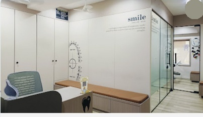

# Payal's Dental Clinic — Website

Production-ready, minimal marketing website for **Payal's Dental Clinic** (Nanpura, Surat), designed under Apple marketing site design standards.



## Features
- **Apple-grade Design**: 8px spatial grid, high-contrast typography, strict single-accent palette (`#0D9488` Teal).
- **Dynamic IST Hours System**: Live calculation of clinic operational status (Morning Clinic: 10:30 AM–1 PM, Evening Clinic: 5 PM–8 PM, Sunday Closed) with real-time indicators and active day highlighting.
- **Real Business Facts**: Authentic address at 1st Floor, Mazda Mension, near Anand Hospital, Nanpura, Surat; 5.0 Google rating across 29 verified reviews.
- **Interactive Consultation Drawer**: Accessible appointment booking dialog with local state handling.
- **Full SEO & Accessibility**: Semantic HTML5, WCAG AA compliant contrast, Open Graph meta tags, and `LocalBusiness` JSON-LD schema.

## Project Structure
```
├── index.html              # Main webpage with semantic structure and JSON-LD schema
├── style.css               # Design tokens, bento grid, and responsive layouts
├── app.js                  # Operating hours evaluator, modal controller, mobile nav
├── assets/                 # Authentic clinic imagery from Google Maps listing
└── docs/
    ├── brand-brief.md      # Phase 1 brand facts, reviews, and identity
    └── design-system.md    # Phase 2 Apple design principles & specifications
```

## Running Locally
```bash
# Python
python -m http.server 3000

# Or Node.js
npx serve -p 3000
```
Open [http://localhost:3000](http://localhost:3000) in your browser.

## Deployment
Deployable with zero configuration to **GitHub Pages**, **Vercel**, **Netlify**, or **Cloudflare Pages**.
